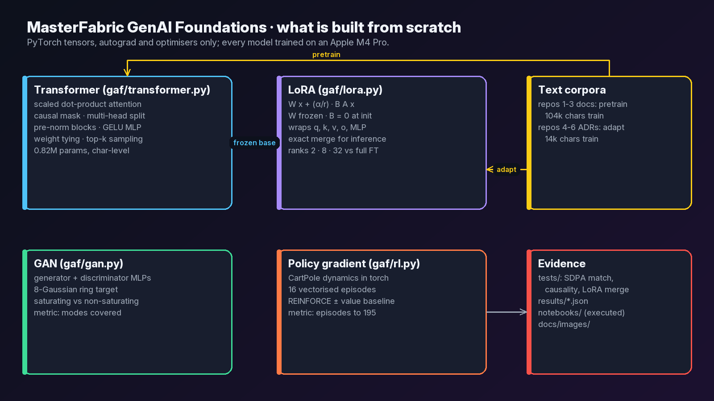
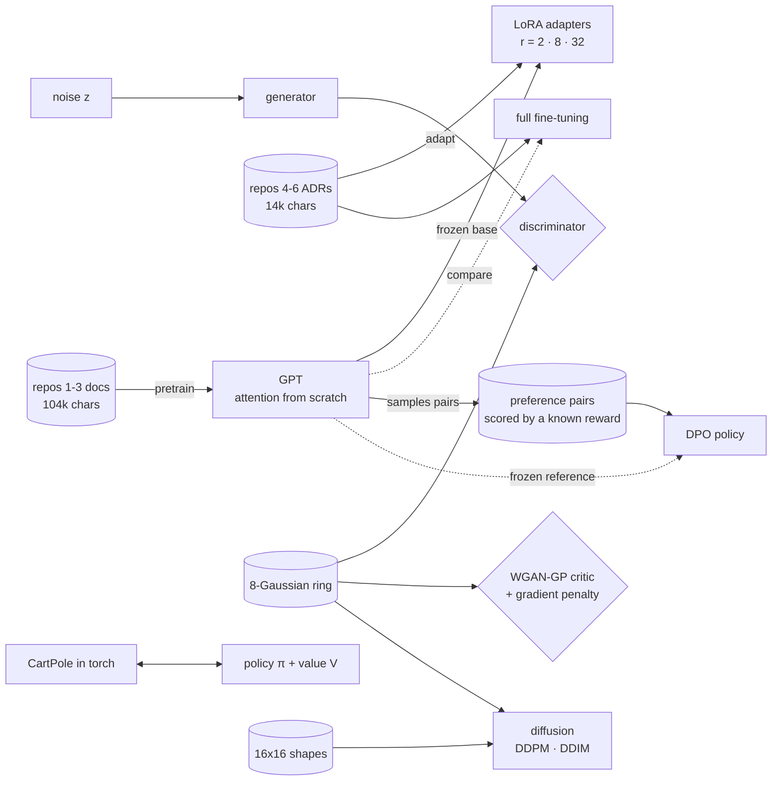
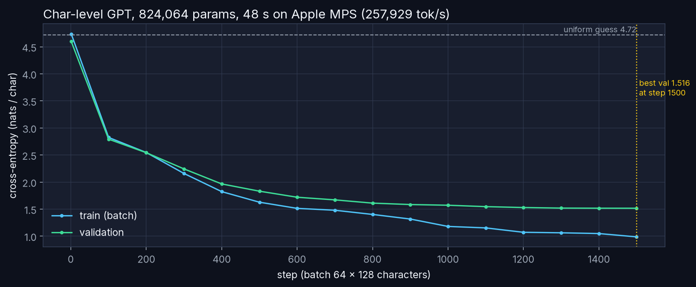
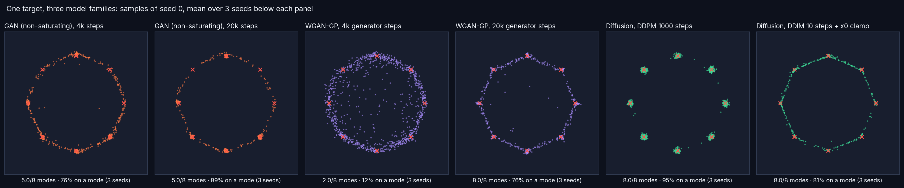
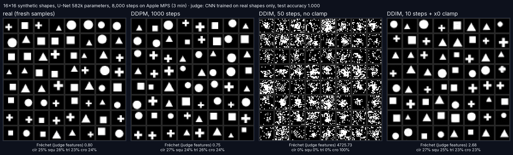
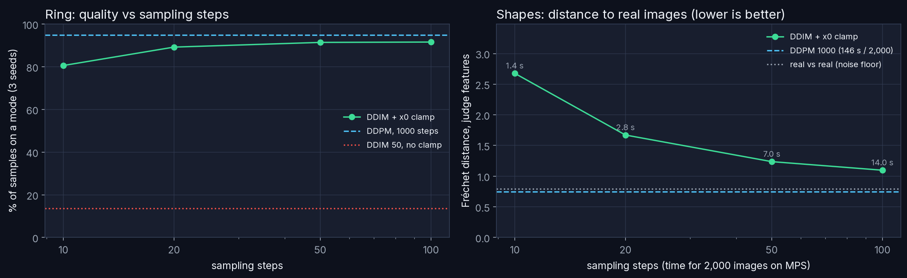
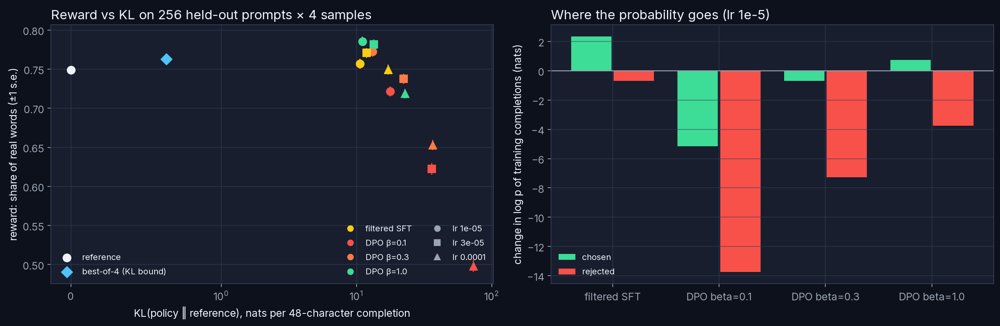

<p align="center"></p>

# MasterFabric · GenAI Foundations

The building blocks of generative AI, written from their equations in PyTorch and trained on a
laptop GPU (Apple M4 Pro, MPS):

1. **Attention and a GPT-style transformer**: a character-level language model.
2. **LoRA**: low-rank adapters, compared with full fine-tuning, including how much each forgets.
3. **A GAN**: generator and discriminator on a target where mode collapse can be counted.
4. **Policy-gradient RL**: REINFORCE with and without a value baseline on a from-scratch CartPole.
5. **WGAN-GP**: the Wasserstein critic with a gradient penalty, on the GAN's target.
6. **A small diffusion model**: DDPM and DDIM, on the same 2-D target and on 16x16 images.
7. **DPO**: direct preference optimisation of the GPT, against filtered SFT and best-of-n sampling.

Each comes with tests, an executed notebook and results in [`results/`](results/). All numbers are
measured, including the runs that overfit or collapsed.

> Part of the MasterFabric data and AI portfolio. The text the models learn from is this
> portfolio's own documentation.

## Contents

[Key results](#key-results) · [Overview](#overview) · [1 Transformer](#1-attention-and-a-gpt-style-transformer) ·
[2 LoRA](#2-lora) · [3 GAN](#3-gan) · [4 RL](#4-policy-gradient-rl) · [5 WGAN-GP](#5-wgan-gp) ·
[6 Diffusion](#6-diffusion) · [7 DPO](#7-dpo) · [Notebooks](#notebooks) · [ADRs](#decisions) ·
[Enterprise mapping](#enterprise-mapping) · [Quickstart](#quickstart) · [Limitations](#limitations) · [Roadmap](#roadmap)

## Key results

| Block | Result | Time (M4 Pro) |
|---|---|---|
| Attention | matches `torch.nn.functional.scaled_dot_product_attention` within 1.5e-7 | test |
| GPT, 0.82M params | validation loss 4.72 (uniform guess) → **1.516** nats/char | 48 s on MPS, 257,929 tok/s |
| LoRA r=8, 9% of weights | new-corpus loss **1.758** vs 1.725 for full fine-tuning; original-corpus loss **1.642** vs 1.747 (less forgetting) | 21 s |
| GAN, non-saturating loss | **4-6 of 8** modes covered, 75-78% of samples on a mode (3 seeds) | 5 s per run, CPU |
| REINFORCE on CartPole | solved (mean return ≥ 195) after **352-560** episodes in all 6 runs | 4 s per run, CPU |
| WGAN-GP, 20k generator steps | **8 of 8** modes in all 3 seeds, 74-77% on a mode (GAN at 20k: still 4-6 of 8) | 101-107 s per run, CPU |
| Diffusion (DDPM) on the same ring | **8 of 8** modes, 95% on a mode (3 seeds); DDIM 20 steps: 8 of 8, 89% | 10 s training, CPU |
| Diffusion on 16x16 shapes, U-Net 582k | balanced classes, judge-feature Fréchet **0.75** (real vs real 0.80); DDIM without x0 clamp: one class of noise | 182 s on MPS |
| DPO on the GPT, β=1.0 | reward (share of real words) 0.749 → **0.786 ± 0.006**; filtered SFT 0.771, best-of-4 0.763 | 11 s per run, MPS |

## Overview

<p align="center"></p>
<p align="center"><sub><b>Figure 1.</b> What is hand-written, and how the parts share targets and models. Only tensors, autograd, basic layers and optimisers come from PyTorch (<a href="docs/adr/0001-from-scratch-scope.md">ADR 0001</a>).</sub></p>



## 1. Attention and a GPT-style transformer

[`gaf/transformer.py`](gaf/transformer.py) implements `softmax(QKᵀ/√d + causal mask) · V`, a
multi-head split, pre-norm residual blocks with a GELU MLP, learned positions, weight tying and
top-k sampling. Tests check:
- the attention against PyTorch's fused kernel;
- that changing future tokens never changes past logits;
- that an untrained model starts at the uniform loss.

<p align="center"></p>
<p align="center"><sub><b>Figure 2.</b> 4 layers, 4 heads, d_model 128, context 128, dropout 0.2, 1,500 steps of 64 × 128 characters. The train/validation gap shows the corpus is small.</sub></p>

| | |
|---|---|
| Parameters | 824,064 (vocabulary of 112 characters) |
| Data | 103,516 training / 11,502 validation characters |
| Best validation loss | 1.516 nats/char (uniform guess: 4.72) |
| Throughput | 257,929 tokens/s training on Apple MPS (48 s) |
| First attempt | d_model 192, dropout 0.1: overfit by step 700 (train 0.72, validation rising to 1.75). Replaced, and kept in the commit history |

A sample after training (temperature 0.8) has the structure of the documents: Markdown headings,
image tags, words like "telemetry", "watermarks" and "Spark". The sentences do not make sense. That
is what 0.8M parameters and 100 KB of text can do.

## 2. LoRA

[`gaf/lora.py`](gaf/lora.py) computes `W x + (α/r) · B A x`. W is frozen and B starts at zero, so
training starts exactly from the base model. `merged()` folds the adapter back into one matrix, so
inference has no extra cost. The pretrained GPT is adapted to a different corpus: the ADRs of repos 4-6.

<p align="center"></p>
<p align="center"><sub><b>Figure 3.</b> Left: validation loss on the new corpus (solid) and on the original corpus (hatched, forgetting), at the best checkpoint. Right: learning curves. Every method overfits the 14k-character corpus after 50-300 steps.</sub></p>

| Method | Trainable | Val loss, new corpus | Val loss, original | Best step | Time |
|---|---|---|---|---|---|
| No fine-tuning | 0 | 2.193 | 1.516 | | |
| Full fine-tuning | 824,064 (100%) | **1.725** | 1.747 | 100 | 14.9 s |
| LoRA r=2 | 18,432 (2.2%) | 1.754 | 1.718 | 300 | 19.7 s |
| LoRA r=8 | 73,728 (9.0%) | 1.758 | **1.642** | 50 | 20.9 s |
| LoRA r=32 | 294,912 (35.8%) | 1.738 | 1.825 | 50 | 19.9 s |

LoRA gets within 0.03 of full fine-tuning while training 2-9% of the weights. At r=2 and r=8 it also
forgets less. It is *not* faster here: on a model this small, the extra matmuls cost more than the
smaller optimiser state saves ([ADR 0003](docs/adr/0003-lora-for-adaptation.md)).

## 3. GAN

[`gaf/gan.py`](gaf/gan.py) trains two 3-layer MLPs adversarially on a ring of eight 2-D Gaussians.
The target is simple on purpose: it makes **mode collapse countable**. A mode counts as covered when
it receives at least 2% of the samples, and a sample is on-mode within 3σ of a mode centre.

<p align="center"></p>
<p align="center"><sub><b>Figure 4.</b> Samples from one run at steps 0, 500, 1,500 and 4,000, and modes covered for 3 seeds per loss.</sub></p>

| Generator loss | Modes covered (of 8) | Samples on a mode | Seeds |
|---|---|---|---|
| Non-saturating, −log D(G(z)) | 4, 5, 6 | 75.1-77.5% | 0, 1, 2 |
| Saturating, log(1 − D(G(z))) (original minimax) | 5, 6, 5 | 32.1-61.2% | 0, 1, 2 |

The non-saturating loss gives sharper samples. Neither loss recovers all 8 modes in 4,000 steps:
the GAN lands its samples near the ring but drops some modes. That partial mode collapse is the
measured result, not a tuned-away one.

## 4. Policy-gradient RL

[`gaf/rl.py`](gaf/rl.py) reimplements the cart-pole equations of motion (Barto, Sutton and Anderson,
1983) in torch, vectorised over 16 parallel episodes capped at 200 steps. REINFORCE uses normalised
discounted returns, optionally minus a learned value baseline.

<p align="center"></p>
<p align="center"><sub><b>Figure 5.</b> Mean episode return per update for 3 seeds of each variant. One plain-REINFORCE run collapses to 150 after about 1,100 episodes and recovers.</sub></p>

| Variant | Episodes until mean return ≥ 195 | Final return (last 10 updates) | Worst return after 600 episodes |
|---|---|---|---|
| REINFORCE | 400, 352, 560 | 189.5, 198.8, 198.8 | 149.5, 188.1, 180.4 |
| + value baseline | 480, 368, 496 | 198.6, 198.7, 200.0 | 182.3, 181.9, 181.6 |

At this scale, the baseline does not speed up learning. It does make the policy more stable after
it is solved (worst dip 182 vs 150).

## 5. WGAN-GP

[`gaf/gan.py`](gaf/gan.py) (`train_wgan_gp`) replaces the discriminator's log loss with a critic score and
penalises `(‖∇ₓ D(x̂)‖ − 1)²` on random interpolates of real and fake points (Gulrajani et al., 2017). Same
generator, same critic network, same target, metric and seeds as section 3; the paper's settings (5 critic steps per
generator step, λ = 10, Adam 1e-4). Because these settings learn more slowly, it is measured at the GAN's 4,000
generator steps and at 20,000, and the GAN is re-run for 20,000 steps as a control.

<p align="center"></p>
<p align="center"><sub><b>Figure 6.</b> One target, three model families (seed 0 shown, means of 3 seeds below each panel). More GAN training sharpens the modes it has and finds no new ones; WGAN-GP and diffusion cover all eight.</sub></p>

| Model, generator steps | Modes covered, seeds 0/1/2 | Samples on a mode | Time per run (CPU) |
|---|---|---|---|
| GAN, non-saturating, 4k | 5 / 4 / 6 | 75-78% | 5 s |
| GAN, non-saturating, 20k | 5 / 4 / 6 | 88-91% | 26-32 s |
| WGAN-GP, 4k | 4 / 2 / 0 | 4-20% | 20-21 s |
| WGAN-GP, 20k | **8 / 8 / 8** | 74-77% | 101-107 s |

At equal generator steps WGAN-GP is worse; given 5x the steps it is the only GAN that finds every mode, at lower
sharpness than the plain GAN. See [ADR 0004](docs/adr/0004-wgan-gp-and-the-ring-benchmark.md).

## 6. Diffusion

[`gaf/diffusion.py`](gaf/diffusion.py) implements denoising diffusion (Ho et al., 2020) from the equations: the
closed-form forward noising `x_t = √ᾱ_t x₀ + √(1−ᾱ_t) ε` with a cosine schedule (T = 1,000), a network trained with
MSE to predict ε, ancestral DDPM sampling over all 1,000 steps, and deterministic DDIM sampling (Song et al., 2021) on
10-100 steps. Two denoisers: an MLP for the ring (6,000 steps, CPU) and a 582k-parameter U-Net for 16x16 images
of four synthetic shapes (8,000 steps of fresh images, 182 s on MPS). Images are judged by a CNN trained on real
shapes only (test accuracy 1.000): its class shares, and a Fréchet distance between its features for real and
generated images (the FID formula with this judge's features, not Inception's).

<p align="center"></p>
<p align="center"><sub><b>Figure 7.</b> Real shapes, DDPM samples, DDIM without the x0 clamp (noise, all judged "cross") and DDIM with the clamp at 10 steps.</sub></p>

<p align="center"></p>
<p align="center"><sub><b>Figure 8.</b> Fewer sampling steps cost quality gradually down to 20 steps; DDPM's 1,000 steps sit at the real-vs-real noise floor.</sub></p>

| Sampler | Ring: modes / on-mode (3 seeds) | Shapes: Fréchet (judge) | Time, 2,000 images (MPS) |
|---|---|---|---|
| DDPM, 1,000 steps | 8 / 94.9% | **0.75** (real vs real: 0.80) | 146 s |
| DDIM, 50 steps, no clamp | 2.3 / 13.6% | 4,726 | 7.0 s |
| DDIM, 50 steps + x0 clamp | 8 / 91.4% | 1.24 | 7.0 s |
| DDIM, 20 steps + x0 clamp | 8 / 89.2% | 1.67 | 2.8 s |
| DDIM, 10 steps + x0 clamp | 8 / 80.6% | 2.68 | 1.4 s |

**Found while running it.** Plain DDIM failed on both tasks. The cosine schedule ends at ᾱ = 2.4e-9, so DDIM's first
step divides the network's error by √ᾱ ≈ 5e-5 and the predicted x₀ explodes. Clamping it to the data range and
recomputing ε fixes it; DDPM never forms x₀ explicitly and is unaffected. A first image run also produced only
crosses: the weight EMA used a fixed 0.999 decay and after 1,000 steps still held 37% of the random initialisation.
See [ADR 0005](docs/adr/0005-diffusion-ddpm-ddim-clamp.md).

## 7. DPO

[`gaf/dpo.py`](gaf/dpo.py) implements the DPO loss (Rafailov et al., 2023):
`−log σ(β[(log π(y_w|x) − log π_ref(y_w|x)) − (log π(y_l|x) − log π_ref(y_l|x))])`, with the pretrained GPT as both
the starting policy and the frozen reference. As in the paper's controlled-sentiment experiment, a known reward
labels the pairs so the outcome can be measured exactly: the share of complete words in a 48-character completion
that are real words of the corpus. 2,048 prompts × 2 reference samples gave 1,722 pairs after ties (chosen 0.85,
rejected 0.61). Evaluation uses 256 held-out prompts × 4 samples, a sampled estimate of KL(policy ‖ reference), and the
loss on the original validation text.

<p align="center"></p>
<p align="center"><sub><b>Figure 9.</b> Left: every grid point (learning rate × β) against filtered SFT and best-of-4. Right: with small β, DPO lowers the probability of the chosen completions too.</sub></p>

| Method | Reward (±1 s.e.) | KL, nats per completion | Val loss, original text |
|---|---|---|---|
| Reference (pretrained) | 0.749 ± 0.006 | 0 | 1.516 |
| Best-of-4 sampling | 0.763 | ≤ 0.64 (analytic bound) | 1.516 (4x inference) |
| Filtered SFT, lr 3e-5 | 0.771 ± 0.006 | 11.9 | 1.583 |
| **DPO β=1.0, lr 1e-5** | **0.786 ± 0.006** | 11.1 | 1.552 |
| DPO β=0.3, lr 1e-5 | 0.773 ± 0.006 | 13.2 | 1.600 |
| DPO β=0.1, lr 1e-5 | 0.721 ± 0.006 | 17.7 | 1.684 |
| DPO β=0.1, lr 1e-4 | 0.498 ± 0.008 | 73.2 | 2.924 |

**Found while running it.** The first grid (lr 1e-4, β 0.03-0.3) made the model worse on the reward it was trained for.
With β=0.1 the chosen completions lose 5.2 nats and the rejected ones 13.8: the loss is met by widening the gap,
and the freed probability goes to text that is neither. With β=1.0 the chosen gain 0.7 and only the rejected lose.
The grid is scored on the same prompts it is reported on, so the best point is optimistic. See
[ADR 0006](docs/adr/0006-dpo-on-the-char-gpt.md).

## Notebooks

Generated and executed by [`notebooks/build_notebooks.py`](notebooks/build_notebooks.py), so every
output is real and the cells can be reviewed as Python:

| Notebook | Live in the notebook |
|---|---|
| [01_attention_and_gpt](notebooks/01_attention_and_gpt.ipynb) | attention vs SDPA (1.5e-7), the causal attention matrix, text generated by the trained model |
| [02_lora](notebooks/02_lora.ipynb) | identity at init, exact merge, parameter counts, the comparison table |
| [03_gan](notebooks/03_gan.ipynb) | a 1,500-step GAN run with its scatter plot |
| [04_policy_gradient](notebooks/04_policy_gradient.ipynb) | a 40-update REINFORCE run reaching ~199 |

## Decisions

| ADR | Decision |
|---|---|
| [0001](docs/adr/0001-from-scratch-scope.md) | What "from scratch" means here |
| [0002](docs/adr/0002-laptop-scale-experiments.md) | Laptop-scale experiments with measured, reproducible results |
| [0003](docs/adr/0003-lora-for-adaptation.md) | Use LoRA for domain adaptation when forgetting matters |
| [0004](docs/adr/0004-wgan-gp-and-the-ring-benchmark.md) | WGAN-GP and diffusion on the GAN's ring, with a 20k-step GAN control |
| [0005](docs/adr/0005-diffusion-ddpm-ddim-clamp.md) | DDPM with a cosine schedule; DDIM only with a clamped x0 |
| [0006](docs/adr/0006-dpo-on-the-char-gpt.md) | DPO reported as reward vs KL against SFT and best-of-n |

## Enterprise mapping

| This repo | Production equivalent |
|---|---|
| `gaf/transformer.py` | Llama, Qwen and Mistral architectures (RoPE, GQA, SwiGLU on top of the same blocks); FlashAttention for the fused kernel |
| `gaf/lora.py` | Hugging Face PEFT, QLoRA; LoRA serving in vLLM (multi-adapter); Cloudera AI fine-tuning studio |
| Forgetting measured on the original corpus | Regression evaluation on general benchmarks before shipping an adapter |
| `gaf/gan.py` | GANs still used for synthetic tabular data (CTGAN) and super-resolution; WGAN-GP's penalty in many GAN trainers |
| `gaf/diffusion.py` | Stable Diffusion / latent diffusion (Hugging Face Diffusers); DDIM and DPM-Solver samplers for fewer steps |
| `gaf/dpo.py` | DPO, IPO and KTO trainers in TRL and OpenRLHF; preference data from human or LLM judges |
| `gaf/rl.py` | PPO and GRPO in RLHF pipelines (TRL, OpenRLHF), where the policy is the LLM and the reward a learned model |
| Executed notebooks + `results/*.json` | Experiment tracking (MLflow, see masterfabric-airflow-mlops) |

## Quickstart

```bash
git clone https://github.com/masterfabric/masterfabric-genai-foundations && cd masterfabric-genai-foundations
make venv        # uv, Python 3.12, pinned torch / notebook / plotting versions
make test        # 14 tests
make all         # GPT, LoRA, GAN, WGAN-GP, diffusion, DPO, RL (about 25 minutes on an M4 Pro), then notebooks and charts
make wgan        # or one block at a time: wgan, diffusion, dpo, gan, rl, lora
```

It runs on CUDA or CPU as well. `gaf.common.device()` picks MPS, then CUDA, then CPU. To browse
interactively, run `make lab` (JupyterLab on `127.0.0.1:17888`, after `uv pip install -p .venv jupyterlab`).

## Limitations

- **Toy scale on purpose.** 0.8M parameters, a 104k-character corpus, a 2-D GAN and CartPole. The
  mechanics are those of real systems; the numbers do not transfer to real model sizes.
- **Small data, so overfitting.** The GPT has a train/validation gap of 0.5 nats. Every fine-tuning
  method overfits the 14k-character corpus within 50-300 steps; results use the best validation
  checkpoint.
- **LoRA speed and memory benefits are not shown.** They appear at billion-parameter scale; here LoRA
  was slower in wall time.
- **Few seeds.** GAN and RL use 3 seeds per setting. GPT and LoRA use one seed. Differences smaller
  than the seed-to-seed spread should not be read as real.
- **Simplified transformer.** Learned absolute positions, standard multi-head attention and GELU. No
  RoPE, GQA, SwiGLU or KV cache in generation.
- **Diffusion at toy scale.** 2-D points and 16x16 binary-like shapes. The image judge is so accurate that DDPM
  samples are indistinguishable from real ones by its Fréchet distance (0.75 vs 0.80 real vs real); it ranks
  samplers, not DDPM against real data. No latent diffusion, no text conditioning.
- **DPO's reward is a proxy.** "Share of real words" is chosen to be measurable; it is not a human preference. One run
  per grid point; MPS is not bit-deterministic (a re-run moved one point by 0.01).
- **WGAN-GP gets more compute.** 5 critic steps per generator step; at the GAN's own budget it does worse.
- **Shared machine.** Timings are from a laptop running other work and were not repeated. Some CPU runs (WGAN-GP,
  the 20k GAN control, the diffusion ring) overlapped in time, so their wall times are upper bounds.

## Roadmap

- KV cache in `generate()` and a measured speed-up; RoPE and grouped-query attention.
- PPO and a toy RLHF loop with a learned reward model, compared with DPO on the same pairs and reward.
- Notebooks for WGAN-GP, diffusion and DPO.
- Classifier-free guidance for class-conditional shapes; a harder image set where the judge can tell DDPM from real.
- QLoRA-style 4-bit base weights with LoRA on top.

## License

AGPL-3.0, see [LICENSE](LICENSE). The additional attribution and trademark terms, and the
third-party licenses, are listed in [NOTICE](NOTICE).
See also [CONTRIBUTING](CONTRIBUTING.md), [CODE_OF_CONDUCT](CODE_OF_CONDUCT.md) and [SECURITY](SECURITY.md).
